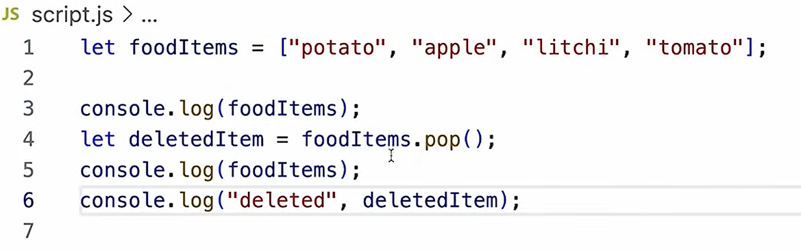
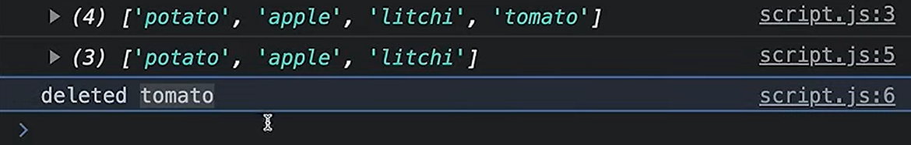
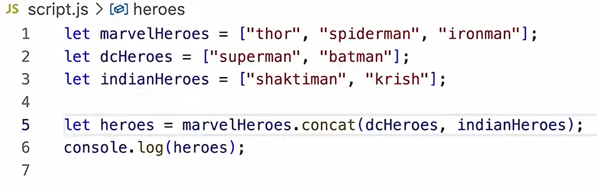
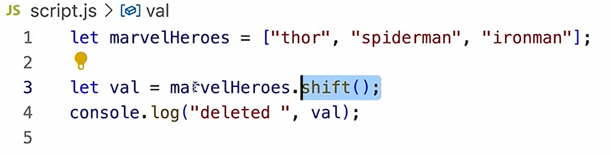
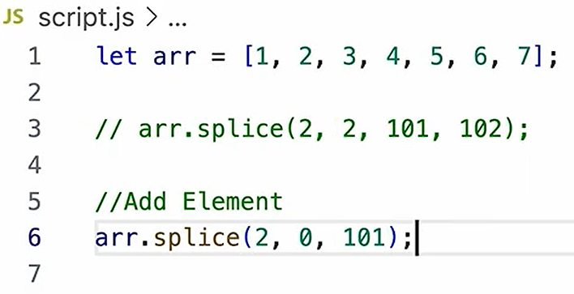

Arrays in js is a way of storing data in a linear way
* elements in an array can be accessed through indecies arr[ 0 ]
* elements in an array are mutable

//Array methods
1. Push(): add to end
2. pop(): delete from the end & return
3. toString(): converts array to string & returns new array
4. concat(): to join two arrays & returns new array
5. shift(): deletes the first element. this method performs changes in the original array
6. unshift(): add to the start
7. slice(): returns a piece of array. dosent change the original array. 
    note: the element of the ending index dosent count
    slice(startIDX,endIDX)
8. splice(): change the original array(add, remove, replace)
    splice(startIDX, del_count, newelement)

EXAMPLE:
1. 
fooditems=["a","b","c"];

fooditems.push("d","e")

fooditems=["a","b","c","d","e"];

2. 
    

4.  
5. 
8. 