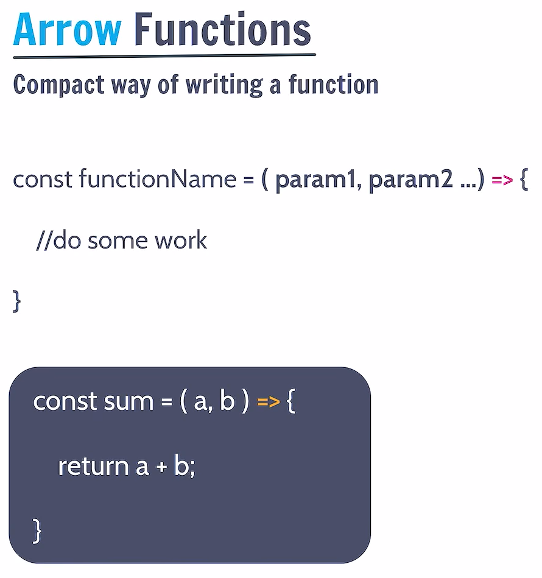
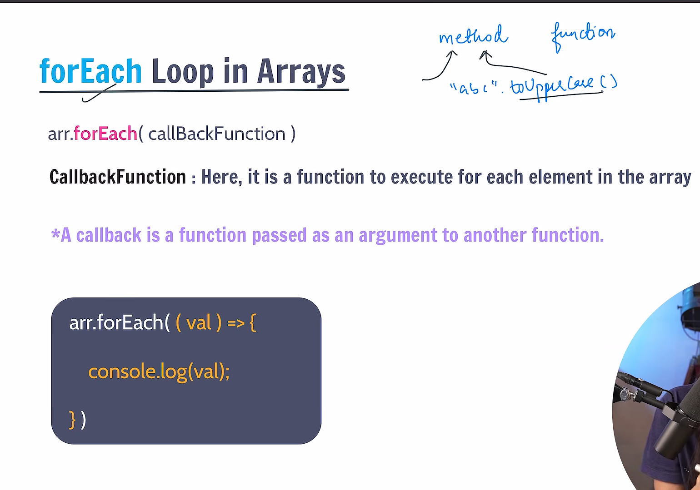
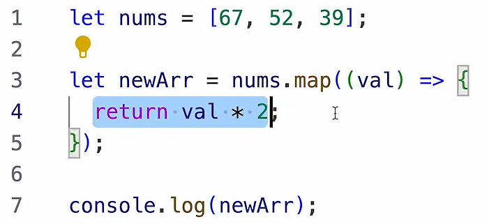
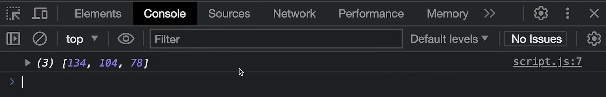
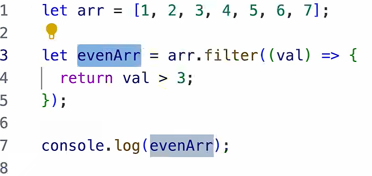
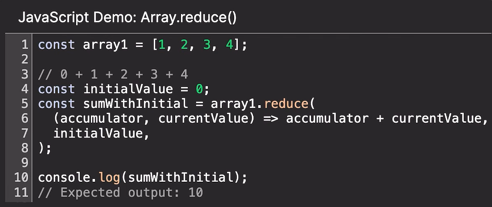
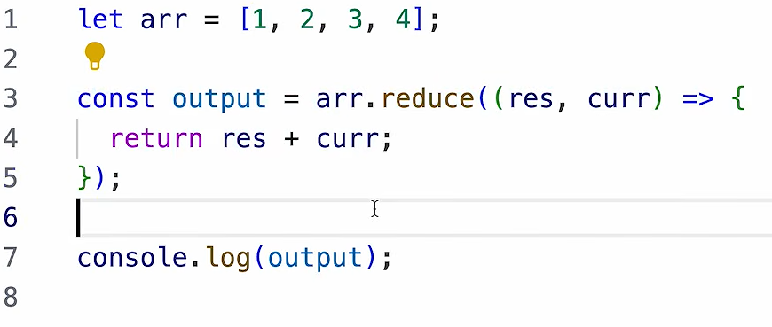
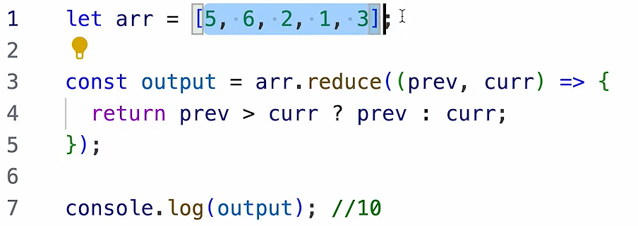

 functions are used to reduce redundancy
 return -> keyword returns only one value
 arrow functions -> a compact way of writing functions
    

forEach loop in arrays

note: callback functions

note: Q.what are higher order functions/methods?
A. functions which take other functions as parameters or return other functions as their output.

//IMPORTANT ARRAY METHODS
1. map =creates a "new array" with results of some operation. the value its callbacks returns are used to form a new array
EXAMPLE: arr.map(callbackfxn(value,index,array))
         
         

2. filter = creates a new array of elements that give true for condition/filter.
   EXAMPLE: all 7 elements
            

3. reduce = preforms some operations & reduces the array to a single value. it returns that single value.
   EXAMPLE: 
            
            